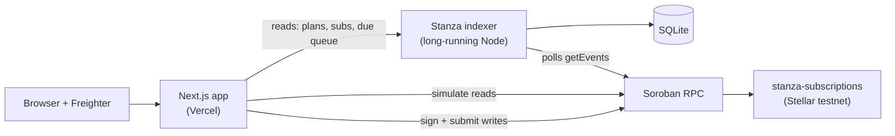

# Deployment

Three deployables, three different hosting models: the contract on Stellar
testnet, the web app on Vercel, and the indexer on a host that keeps a process
alive.



## 1. Contract (required)

The contract must exist before the app can do anything.

### Option A — Stellar CLI

```bash
rustup target add wasm32v1-none
pnpm contract:build

stellar keys generate stanza-deployer --network testnet --fund
stellar contract deploy \
  --wasm contracts/stanza/target/wasm32v1-none/release/stanza_subscriptions.wasm \
  --source stanza-deployer \
  --network testnet
```

The command prints `C…`. There is no `init` step: the contract is usable
immediately.

### Option B — script

```bash
STELLAR_SECRET=S... pnpm deploy:testnet
```

Without `STELLAR_SECRET` the script generates and funds a throwaway testnet
keypair, then writes `deployments/testnet.json`.

### After deploying

1. Put the id in `apps/web/.env.local` (`NEXT_PUBLIC_STANZA_CONTRACT_ID`) and
   `indexer/.env` (`STANZA_CONTRACT_ID`).
2. Commit `deployments/testnet.json` so contributors and the docs point at the
   same contract.
3. Smoke-test:

```bash
stellar contract invoke --id $CONTRACT --network testnet -- plan_count
```

## 2. Web app on Vercel

The app is a standard Next.js 14 monorepo package. [`vercel.json`](https://github.com/Streams-Hq/stanza/blob/main/vercel.json)
already sets the build command and output directory.

1. Push the repo, then **Add New → Project** in Vercel and import it.
2. **Root Directory:** leave it at the repository root. The root `vercel.json`
   builds the SDK first and then the web app.
3. **Framework preset:** Next.js (detected).
4. Add the environment variables below for **Production** and **Preview**:

   | Variable | Value |
   | --- | --- |
   | `NEXT_PUBLIC_STELLAR_NETWORK_PASSPHRASE` | `Test SDF Network ; September 2015` |
   | `NEXT_PUBLIC_SOROBAN_RPC_URL` | `https://soroban-testnet.stellar.org` |
   | `NEXT_PUBLIC_STANZA_CONTRACT_ID` | your `C…` contract id |
   | `NEXT_PUBLIC_INDEXER_URL` | public URL of the deployed indexer |
   | `NEXT_PUBLIC_DEFAULT_TOKEN_ADDRESS` | XLM SAC address |
   | `NEXT_PUBLIC_TOKEN_DECIMALS` | `7` |
   | `NEXT_PUBLIC_EXPLORER_BASE` | `https://stellar.expert/explorer/testnet` |

5. Deploy. Vercel runs `pnpm install --frozen-lockfile`, builds
   `@stanza/sdk`, then builds `web`.
6. **Redeploy after any `NEXT_PUBLIC_*` change.** Next.js inlines them at build
   time; changing a value without a build leaves the old value in the bundle.

!!! note "Vercel is optional but recommended"
    The web app also runs on any Node host (`pnpm --filter web start`) or as a
    static export target. Vercel is the least-configuration option because it
    understands Next.js output.

The app degrades gracefully without an indexer: plan and subscription reads fall
back to Soroban RPC simulations, and only the curated "Explore" list shrinks to
the most recent 24 plans.

## 3. Indexer (optional for reads, required for cached lists)

A long-running Node process with a SQLite file — **not** a Vercel serverless
function.

| Setting | Value |
| --- | --- |
| Root directory | `indexer` (or repo root with a filter) |
| Install | `pnpm install --frozen-lockfile` |
| Build | `pnpm --filter @stanza/indexer build` |
| Start | `node dist/server.js` |
| Health check | `GET /health` (includes `lastLedger`) |
| Persistent disk | mount for `DB_PATH` (e.g. `/data/stanza.sqlite`) |
| Env | `STANZA_CONTRACT_ID`, `SOROBAN_RPC_URL`, `STELLAR_NETWORK_PASSPHRASE`, `DB_PATH` |

Without a persistent disk the index rebuilds from `START_LEDGER` on every
restart. With the cursor stored in the `meta` table, restarts resume exactly
where they stopped.

## Wiring checklist

| Value | Must match across |
| --- | --- |
| Contract id | `NEXT_PUBLIC_STANZA_CONTRACT_ID` (web) = `STANZA_CONTRACT_ID` (indexer) = `deployments/testnet.json` |
| Network | `NEXT_PUBLIC_STELLAR_NETWORK_PASSPHRASE` = indexer passphrase = Freighter's selected network |
| Indexer URL | `NEXT_PUBLIC_INDEXER_URL` = public HTTPS URL of the indexer service |

## Post-deployment verification

1. `GET /health` returns `{ "status": "ok", "lastLedger": > 0 }`.
2. `GET /api/plans` includes the demo plan (or your plan).
3. Open the web app, connect Freighter on testnet, and load `/plans/0`.
4. Publish a plan, subscribe with an allowance, and charge one cycle.
5. Confirm the `charged` event on Stellar.Expert and that the merchant balance
   increased by exactly one cycle price.

## Costs

- **Contract:** one upload + one create transaction on testnet (free testnet
  XLM), plus rent pre-paid in the contract's TTL extensions.
- **Vercel:** hobby tier is enough; the app is static + client-side RPC calls.
- **Indexer:** the smallest always-on instance with a 1 GB disk.
- **Per charge:** one Stellar network fee, a fraction of a cent.
